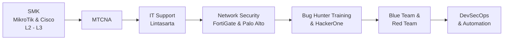

<!-- ===================== HEADER ===================== -->

 

*"Belajar, praktik, lalu dokumentasikan."*

 

<!-- ===================== ABOUT ===================== -->
## 👨‍💻 Tentang Saya

Saya memulai perjalanan di dunia IT sejak SMK dengan fokus pada **jaringan komputer**, yaitu **MikroTik** dan **Cisco** dari **Layer 2 hingga Layer 3**. Setelah lulus, saya bekerja sebagai **IT Support Specialist di Lintasarta**, menangani infrastruktur enterprise di seluruh cabang Indonesia.

Fokus saya hari ini:

| | Area | Deskripsi |
|:-:|------|-----------|
| 🛡️ | **Blue Team** | Monitoring, endpoint security (XDR), hardening Windows Server & Active Directory, network security |
| 🐞 | **Red Team** | Web security testing dan *responsible disclosure* untuk membantu mengamankan website instansi pemerintah |
| 🔐 | **DevSecOps** | Mengintegrasikan keamanan ke pipeline CI/CD (SAST, SCA, container & IaC scanning) |
| ⚙️ | **Automation** | Ansible, Jenkins, GitHub Actions, GitLab CI, dengan Python & Go sebagai pendukung tooling |

<!-- ===================== EXPERIENCE ===================== -->
## 💼 Pengalaman Kerja

### IT Support Specialist · Lintasarta
*Menjaga kelancaran operasional dan keamanan infrastruktur IT di seluruh cabang Lintasarta di Indonesia.*

| Area | Tanggung Jawab |
|------|----------------|
| 🗂️ **Active Directory** | Mengelola AD pada Windows Server, *preventive maintenance*, dan *security hardening* bersama tim CISO |
| 📡 **Network Monitoring** | Memantau dan mengelola access point di seluruh kantor cabang untuk konektivitas dan keamanan yang konsisten |
| 🎧 **Technical Support** | Menyelesaikan kendala software, VPN, OS, dan layanan jaringan |
| 🛡️ **Endpoint Security** | Mengelola XDR (Trend Micro) untuk deteksi dan respons ancaman |
| 🔥 **Network Security** | Mendukung operasional FortiGate dan Palo Alto |
| 🎥 **Meeting Support** | Menyiapkan Zoom, Microsoft Teams, audio-visual, dan kebutuhan IT meeting lainnya |
| 📣 **IT Communications** | Menyebarkan informasi penting IT kepada karyawan melalui email |
| 🏢 **Data Center** | Pengecekan rutin untuk menjaga performa dan keamanan |
| 🆕 **Teknologi Baru** | Mendukung adopsi teknologi baru bagi end user |

<!-- ===================== CERT ===================== -->
## 🎓 Sertifikasi & Pelatihan

| 🏅 | Nama | Bidang |
|:-:|------|--------|
| ✅ | **MikroTik Certified Network Associate (MTCNA)** | Networking |
| ✅ | **Bug Hunter Training** | Web Security |

<!-- ===================== SECURITY ===================== -->
## 🐞 Security Research

- Menemukan **kerentanan pada situs web nasional** melalui program pelatihan bug hunter, dilaporkan secara bertanggung jawab untuk membantu pengamanan website pemerintah.
- Aktif berlatih di **HackerOne** untuk terus mengasah kemampuan.
- Fokus pada **reconnaissance**, **vulnerability scanning**, dan **web application security**.

<!-- ===================== STACK ===================== -->
## 🛠️ Tech Stack

<b>💻 OS, Languages & Automation</b>

 

  

<b>🔐 DevSecOps & Security Automation</b>

 

<b>🌐 Networking & Firewalls</b>

 

<b>🛡️ Endpoint Security</b>

 

<!-- ===================== ROADMAP ===================== -->
## 🗺️ Perjalanan Belajar

<!-- ===================== STATS ===================== -->
## 📊 GitHub Stats

<!-- ===================== FOOTER ===================== -->

*Terima kasih sudah berkunjung. Mari berdiskusi dan berkolaborasi!* 🤝

